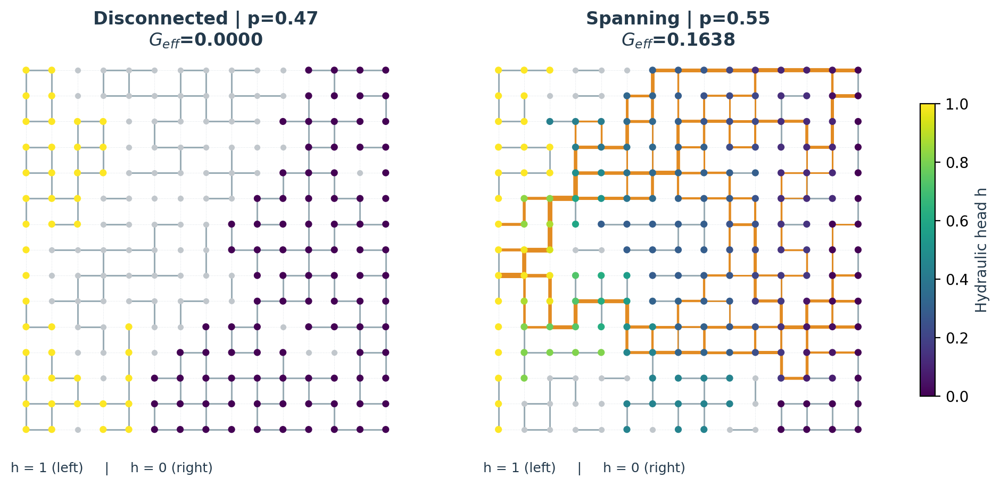

# جریان در شبکه تصادفی دوبعدی: تحلیل عدم‌قطعیت و حساسیت

**مرحله دوم — PINN پارامتری:** [کد، وزن آموزش‌دیده و نتایج مستقل](parametric_pinn/README.md) · [گزارش مقایسه کامل فارسی](parametric_pinn/reports/comparison_fa.pdf) · [ارائه مقایسه](parametric_pinn/reports/comparison_slides.pdf). این مرحله شامل ۳۶ آزمون موفق و مقایسه جفت‌شده دقت، فیزیک، آمار، حساسیت و هزینه است. خروجی‌های مطالعه اولیه زیر حفظ شده‌اند.

این مخزن، پروژه پیوست‌شده **Mini-project: Uncertainty and Sensitivity Analysis of Flow in a 2D Random Network** را از مدل‌سازی و اعتبارسنجی تا تحلیل آماری، حساسیت و گزارش نهایی پوشش می‌دهد. شبیه‌سازی‌ها اجرا شده‌اند و فایل‌های نتایج، نمونه‌های واقعی هستند.

**گزارش فارسی:** [PDF هفت‌صفحه‌ای](reports/report_fa.pdf) · [نسخه HTML](reports/report_fa.html)

**English report:** [PDF](reports/report_en.pdf) · [HTML](reports/report_en.html)

**ارائه ۱۲ اسلایدی:** [PDF](reports/presentation_en.pdf) · [PowerPoint قابل‌ویرایش](reports/presentation_en.pptx) · [یادداشت سخنران](reports/presentation_notes.md)

**دفترچه اجراشده:** [analysis.ipynb](notebooks/analysis.ipynb)
**English instructions:** [README_EN.md](README_EN.md)

## یافته‌های اصلی

- در مجموع **۲۴۸٬۱۸۸ ارزیابی مدل** اجرا شد؛ ۹ سناریوی اصلی هرکدام ۱۰٬۰۰۰ نمونه دارند.
- در شبکه ۲۵×۲۵ با σ=۱، افزایش δ از صفر به ۰٫۲۵، میانگین رسانایی را از **۰٫۰۱۸۲۵۳** به **۰٫۰۹۹۲۳۱** رساند؛ حدود **۵٫۴۴ برابر**.
- برای δ=۰٫۲۵ و σ=۱، **۴۸٫۶۲٪** تحقق‌ها جریان صفر داشتند. فاصله اطمینان مونت‌کارلو ۹۵٪ میانگین **[۰٫۰۹۶۶۰۳، ۰٫۱۰۱۸۵۹]**، میانه **۰٫۰۱۹۵۳۱** و صدک ۹۵ **۰٫۳۸۳۸۲۵** بود.
- تحلیل گروهی سوبول نشان داد متغیر نهفته تعیین‌کننده احتمال اتصال، عامل غالب است. شاخص کل آن **۰٫۸۲۵** و شاخص کل δ برابر **۰٫۳۵۸** بود؛ برهم‌کنش‌ها مهم‌اند و شاخص‌های کل هم‌پوشانی دارند.
- تغییر σ و میدان رسانایی، مقدار جریان را عوض می‌کند؛ چون همه رسانایی‌های فعال مثبت‌اند، بر وجود مسیر عبوری اثر ندارد.
- **۲۴ آزمون خودکار** موفق بود. در ۱۰۰۰ شبکه تکمیلی، بیشترین باقیمانده بقای جریان حدود **۲٫۷۵×۱۰⁻¹³** بود.
- اثر اندازه شبکه نزدیک آستانه مهم است. این مدل بی‌بُعد و اکتشافی است و با داده سنگ واقعی کالیبره نشده است.



## مدل و انتخاب‌های مطالعه

در هر تحقق فقط **یک احتمال اتصال سراسری** نمونه‌برداری می‌شود:

```text
p = 0.5 + δ U,           U ~ Uniform(-1, 1)
active_e = (W_e < p),    W_e ~ Uniform(0, 1)
g_e = active_e exp(σ Z_e), Z_e ~ Normal(0, 1)
Q_ij = g_ij (h_i - h_j)
sum_j Q_ij = 0
G_eff = Q_in / Δh,       Δh = 1
```

شبکه مبنا ۲۵×۲۵ گره و ۱۲۰۰ لینک بالقوه دارد. هد مرز چپ ۱، راست صفر و مرزهای بالا و پایین بدون جریان‌اند. خوشه‌های غیرعبوری از دستگاه حل حذف می‌شوند؛ رسانایی مصنوعی یا نشتی اضافه نمی‌شود. هد جزیره‌های جدا از دو مرز نامعین است و با `NaN` ثبت می‌شود؛ جریان آن‌ها صفر است.

مقادیر اصلی δ برابر ۰، ۰٫۱۰ و ۰٫۲۵ و σ برابر ۰، ۱ و ۲ است. اندازه‌های ۱۵ و ۴۱ برای بررسی اثر اندازه و ۹ مقدار p ثابت از ۰٫۳۰ تا ۰٫۷۰ برای گذار اتصال اجرا شده‌اند. تحلیل حساسیت با ورودی‌های مستقل δ، σ، U، میدان آرایش لینک‌ها و میدان رسانایی انجام می‌شود. در آن، δ روی [۰، ۰٫۲۵] و **σ** روی [۰، ۲] یکنواخت است؛ توزیع یکنواخت برای σ² فرض نشده است.

## اجرای سریع

Python 3.12 برای نتایج ثبت‌شده استفاده شده است. برای اجرای مدل و آزمون‌ها:

```bash
python -m venv .venv
source .venv/bin/activate
python -m pip install -e '.[dev]'
python -m pytest -q
python scripts/demo.py --n 25 --p 0.6 --sigma 1 --seed 42
```

در ویندوز، محیط را با `.venv\Scripts\activate` فعال کنید. اجرای مدل، شکل‌ها و تحلیل آماری به نرم‌افزار خارجی یا کلید API نیاز ندارد.

## بازتولید کامل

برای بازتولید نسخه‌های استفاده‌شده، گزارش‌های PDF و پاورپوینت و دفترچه:

```bash
python -m pip install -r requirements.txt
python -m pip install -e .
make all
```

ساخت PDF فارسی به WeasyPrint، کتابخانه سیستمی Pango و قلم فارسی نیاز دارد. در Debian/Ubuntu می‌توان بسته‌های `libpango-1.0-0`، `libpangoft2-1.0-0` و `fonts-noto-core` را نصب کرد. قلم استفاده‌شده `Noto Naskh Arabic` است. این وابستگی‌ها برای اجرای حل‌گر لازم نیستند. اگر `make` ندارید، فرمان‌های زیر را به‌ترتیب اجرا کنید:

```bash
python -m pytest -q
OPENBLAS_NUM_THREADS=1 python scripts/run_study.py
python scripts/make_figures.py
python scripts/make_reports.py
python scripts/make_presentation.py
python scripts/make_notebook.py
python scripts/audit_results.py
```

در PowerShell متغیر محیطی را جدا تنظیم کنید: `$env:OPENBLAS_NUM_THREADS="1"`.

اجرای کامل مطالعه عددی روی میزبان این کار حدود **۱۸۸ ثانیه** طول کشید؛ این زمان، تضمین عملکرد روی سیستم دیگر نیست و زمان ساخت گزارش و دفترچه را شامل نمی‌شود. بذر پایه `20261104` و جریان‌های تصادفی در `results/manifest.json` ثبت شده‌اند. بازتولید دقیق زمان اجرا و بایت‌های PDF/دفترچه به محیط وابسته است؛ مقادیر عددی با نسخه‌های ثبت‌شده باید تا دقت محاسباتی قابل‌بازتولید باشند.

برای ساخت دوباره گزارش از داده‌های موجود، بدون تکرار شبیه‌سازی:

```bash
make figures reports slides notebook audit
```

## ساختار فایل‌ها

| مسیر | محتوا |
|---|---|
| `src/flow_network/model.py` | ساخت شبکه، تحلیل مؤلفه‌ها و حل‌گر تنک |
| `tests/` | جواب‌های تحلیلی، اصول فیزیکی و آزمون برآوردگر حساسیت |
| `scripts/run_study.py` | تمام آزمایش‌های عدم‌قطعیت، حساسیت و همگرایی |
| `results/` | همه نمونه‌های خام CSV فشرده و خلاصه‌های آماری |
| `results/README.md` | توضیح فایل‌ها، ستون‌ها و روش فاصله اطمینان |
| `reports/` | گزارش فارسی و انگلیسی، ارائه و یادداشت‌ها |
| `reports/figures/` | هشت شکل در قالب PNG و PDF برداری |
| `notebooks/analysis.ipynb` | دفترچه اجراشده با جدول‌ها و نمودارها |
| `SHA256SUMS` | اثر انگشت فایل‌های تحویل‌شده |

## نکات تفسیر

فاصله اطمینان میانگین، خطای نمونه‌گیری مونت‌کارلو است و بازه پیش‌بینی یک تحقق تازه نیست. توزیع خروجی شامل جرم احتمال در صفر است. احتمال عدم اتصال و آمار جریان مثبت باید جدا گزارش شوند. سناریوها از اعداد تصادفی مشترک استفاده می‌کنند؛ فایل `paired_comparisons.csv` این جفت‌شدن را در مقایسه‌ها لحاظ می‌کند.

در مدل اصلی، میانه رسانایی لینک فعال برابر ۱ است و میانگین آن `exp(σ²/2)` افزایش می‌یابد. کنترل تکمیلی میانگین ثابت از رابطه دقیق `G*=G exp(-σ²/2)` استفاده می‌کند و مدل اصلی را جایگزین نمی‌کند. تحلیل اندازه شبکه، تغییر جامعه شبکه‌ها را بررسی می‌کند و اثبات همگرایی شبکه‌بندی پیوسته نیست.

## منابع

1. Jansen, M. J. W. (1999). *Analysis of variance designs for model output*. Computer Physics Communications 117, 35–43. [DOI](https://doi.org/10.1016/S0010-4655(98)00154-4).
2. Kesten, H. (1980). *The critical probability of bond percolation on the square lattice equals 1/2*. Communications in Mathematical Physics 74, 41–59. [DOI](https://doi.org/10.1007/BF01197577).
3. فایل پروژه ارائه‌شده توسط کاربر؛ دامنه پارامترها، اندازه‌ها و روش عددی طبق آزادی انتخاب مندرج در صورت پروژه، برای این مطالعه انتخاب شدند.
